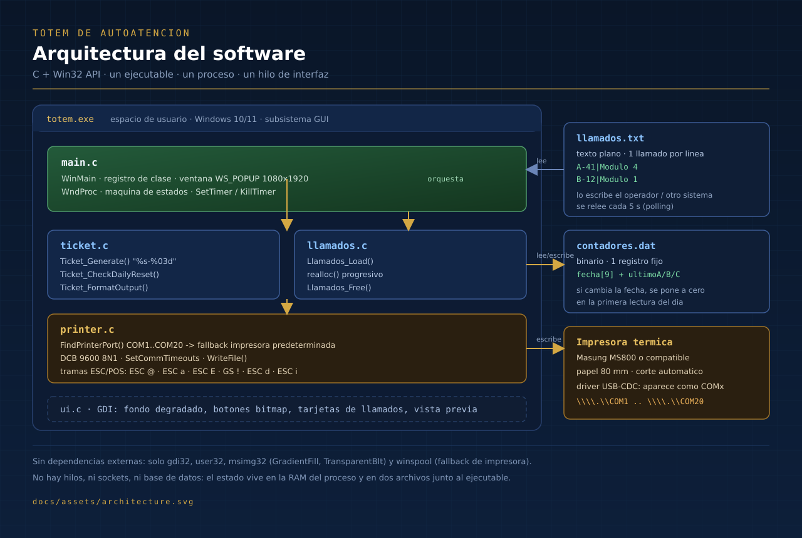

<div align="center">

# Tótem de Autoatención

**Emisión de tickets y panel de llamados para oficinas de atención al público, en C puro sobre Win32 API.**

Un solo ejecutable de 6,9 MB. Sin instalador, sin driver de impresora, sin base de datos, sin runtime de terceros.

[](#11-requisitos)
[](#9-arquitectura-win32)
[](#12-compilación-con-mingw-w64)
[](#7-impresión-escpos-y-la-masung-ms800)
[](#21-limitaciones)
[](#24-licencia)

</div>



---

## Tabla de contenidos

[1. Qué es](#1-qué-es-este-proyecto) · [2. El problema de las filas](#2-el-problema-de-las-filas) · [3. Principio de funcionamiento](#3-principio-de-funcionamiento) · [4. Pantalla de reposo](#4-la-pantalla-de-reposo) · [5. Selección de servicio](#5-selección-de-servicio) · [6. Generación del ticket](#6-generación-del-ticket) · [7. Impresión ESC/POS](#7-impresión-escpos-y-la-masung-ms800) · [8. Panel de llamados](#8-el-panel-de-llamados) · [9. Arquitectura Win32](#9-arquitectura-win32) · [10. Estructura de archivos](#10-estructura-de-archivos) · [11. Requisitos](#11-requisitos) · [12. Compilación](#12-compilación-con-mingw-w64) · [13. Ejecución](#13-ejecución) · [14. Configuración](#14-configuración) · [15. llamados.txt](#15-formato-de-llamadostxt) · [16. Comandos ESC/POS](#16-comandos-escpos) · [17. Pruebas](#17-pruebas) · [18. Rendimiento](#18-rendimiento) · [19. Seguridad](#19-seguridad) · [20. Problemas](#20-solución-de-problemas) · [21. Limitaciones](#21-limitaciones) · [22. Cómo se construyó](#22-cómo-se-construyó) · [23. Referencias](#23-referencias) · [24. Licencia](#24-licencia)

---

## 1. Qué es este proyecto

Un **tótem de autoatención** para Windows: la aplicación que el cliente toca en el hall de una sucursal para sacar un turno numerado, y el panel que muestra qué turno pasa a qué módulo. Ocupa la pantalla completa de un monitor vertical de 1080 × 1920, ofrece tres servicios en la mitad inferior, imprime un ticket correlacionado en una térmica de 80 mm y exhibe los llamados en la mitad superior. No hay menús, ni configuración en pantalla, ni login: el operador no interactúa con la interfaz y el cliente solo tiene tres botones grandes.

El binario de 6,9 MB (casi todo, bitmaps embebidos) arranca en menos de un segundo, no escribe en el registro, no abre puertos de red y se desinstala borrando una carpeta.

> **Estado real:** compila con MinGW-w64 y el binario está en el repositorio. **No hubo acceso a hardware físico** (ni pantalla táctil de 1080 × 1920, ni impresora Masung MS800), así que las pruebas son de compilación y revisión estática. Todo lo que depende del firmware o del driver táctil está marcado como *a validar en campo*. Ver [Limitaciones](#21-limitaciones).

---

## 2. El problema de las filas

La fila única produce tres patologías: el cliente no sabe cuánto falta y no puede sentarse ni irse y volver; el orden se rompe ("guardo el lugar", entra un acompañante, aparece un trámite urgente); y el mostrador pierde trazabilidad, porque sin números no hay forma de saber cuántos clientes se atendieron ni cuál es la demanda real por servicio.

Un sistema de turnos resuelve los tres con dos piezas: **un número único por cliente** y **un canal público que dice qué número pasa a qué módulo**. Eso es lo que implementa este programa, con una particularidad: el canal de llamados no es una base de datos ni un socket, es **un archivo de texto que el operador reescribe**. El tótem no necesita integración con un gestor de turnos para arrancar: se opera el primer día con el Bloc de notas y, más adelante, se conecta el archivo a una carpeta compartida o a un script. La interfaz entre ambos mundos es un contrato de dos columnas.

---

## 3. Principio de funcionamiento

```
CLIENTE                  TÓTEM                              MUNDO EXTERNO
   │ toca "Créditos"        │                                     │
   ├───────────────────────►│ 1. hit test                         │
   │                        │ 2. Ticket_Generate("B")             │
   │                        │    lee y reescribe contadores.dat   │
   │                        │ 3. Ticket_FormatOutput()            │
   │                        │ 4. Printer_PrintTicket() ───────────┼──► térmica
   │                        │ 5. vista previa 2 s                 │
   │◄───────────────────────┤ 6. vuelve al panel de llamados      │
   │                        │◄── relee llamados.txt cada 5 s ─────┼◄── operador
```

1. **Toque.** `WM_LBUTTONDOWN` entrega coordenadas y `UI_HitTestButton()` decide si el punto cae en alguno de los tres servicios.
2. **Numeración.** `Ticket_Generate()` lee `contadores.dat`, compara la fecha guardada con la de hoy, incrementa el contador del prefijo y reescribe el archivo **antes** de imprimir. El número existe aunque la impresora falle: es un contador de negocio, no de impresiones.
3. **Formateo.** `Ticket_FormatOutput()` arma un bloque de ~250 bytes con cabecera, número, criterio, fecha larga y hora.
4. **Impresión.** `Printer_PrintTicket()` abre el primer puerto serie disponible, lo configura a 9600 8N1 y escribe la secuencia ESC/POS línea por línea.
5. **Confirmación visual.** La mitad superior se convierte durante 2 segundos en una tarjeta con el número en 120 px; el cliente asocia el papel con la pantalla.
6. **Reposo.** Un temporizador devuelve la vista al panel y se reanuda el refresco de 5 segundos.

---

## 4. La pantalla de reposo

La pantalla se divide en dos mitades exactas de 960 px separadas por una línea dorada de 2 px. Esa división es el contrato de lectura del tótem.

```
┌──────────────────────────────────────┐ y=0
│           LLAMADOS ACTIVOS           │
│      ─────────────────────           │
│  ┌────────────────────────────────┐  │
│  │  A-041  │  Módulo 4           │  │
│  └────────────────────────────────┘  │
│  ┌────────────────────────────────┐  │
│  │  B-012  │  Módulo 1           │  │
│  └────────────────────────────────┘  │ y=960
├──────────────────────────────────────┤ ← línea dorada
│  ┌────┐ Atención General            │
│  └────┘ Atención al cliente...      │
│  ┌────┐ Créditos                    │
│  └────┘ Solicitud y consulta...     │
│  ┌────┐ Preferencial                │
│  └────┘ Adultos mayores...          │ y=1920
└──────────────────────────────────────┘
```

**Mitad superior (0–960):** hasta **cuatro** llamados. Cada uno ocupa una tarjeta con fondo azul petróleo, borde redondeado y una línea vertical dorada que separa el número (72 px, oro) del módulo (52 px, blanco). Si `llamados.txt` tiene más de cuatro líneas se muestran las cuatro primeras: el panel está pensado para el "ahora", no para el historial. La altura se calcula al dibujar, `slotH = (960 - 190 - 60) / n` con piso de 160 px: con un llamado la tarjeta se estira, con cuatro se compacta. No hay scroll ni paginación.

**Mitad inferior (960–1920):** los tres accesos a servicio, con el texto "Seleccione su tipo de atención" en gris tenue a 20 px del borde inferior. **Sin llamados:** la mitad superior muestra "Sin llamados activos" centrado en gris apagado, sin íconos ni animaciones.

El fondo no es negro sino un degradado vertical de `#1A2A4A` (abajo) a `#0A1628` (arriba) hecho con `GradientFill`: en pantallas táctiles de bajo brillo evita el efecto espejo del negro plano. La mitad superior se pinta encima con un rectángulo casi opaco `RGB(8,16,32)` para dar contraste a las tarjetas.

---

## 5. Selección de servicio

Los servicios se definen en dos lugares que deben mantenerse sincronizados: `main.c` (prefijo y criterio del ticket) y `ui.c` (nombre visible y descripción).

| Botón | Bitmap | Prefijo | Criterio impreso | Descripción en pantalla |
|---|---|---|---|---|
| Verde | `btn_verde.bmp` | `A` | Atencion General | "Atencion al cliente y tramites generales" |
| Azul | `btn_azul.bmp` | `B` | Creditos | "Solicitud y consulta de creditos" |
| Rojo | `btn_rojo.bmp` | `C` | Preferencial | "Atención preferencial para adultos mayores y personas con discapacidad" |

Los botones miden 220 × 200 px, arrancan en `x = 80`, `y = 1020` y se separan 30 px: ocupan las franjas 1020–1220, 1250–1450 y 1480–1680, con 240 px libres al fondo para el texto de instrucción y para que el último botón no quede contra el marco del monitor.

`UI_HitTestButton()` no prueba el rectángulo del botón sino un área mucho mayor: de `BUTTON_X - 20` a `SCREEN_WIDTH - 20` en horizontal y 20 px arriba y abajo en vertical. En la práctica **toda la franja horizontal del botón es tocable**, incluido el texto de la derecha: un toque fallido en un tótem termina en un cliente golpeando la pantalla. Al pasar el puntero el cursor cambia a mano (`IDC_HAND`) y al presionar el botón se dibuja 5 px más abajo (`dy = 5`) con una pausa de 100 ms antes de imprimir.

---

## 6. Generación del ticket

El número se arma con una línea y el formato es `{PREFIJO}-{NNN}`, con tres dígitos y ceros a la izquierda (`A-001`, `B-013`):

```c
snprintf(out, maxlen, "%s-%03d", prefix, *contador);
```

El contador es **por prefijo y por día**. A las 00:00 del día siguiente, la primera emisión detecta el cambio de fecha y reinicia los tres contadores: no hay tarea programada ni servicio a medianoche, el reinicio es perezoso (*lazy*) y ocurre en la primera lectura después del cambio de día. Si el tótem queda apagado el fin de semana, el lunes arranca en `A-001` sin ningún mantenimiento. Al superar 999, `snprintf` no trunca y produce `A-1000`, de cuatro dígitos, que la impresora acepta igual.

`contadores.dat` guarda un solo registro:

```c
typedef struct {
    char fecha[9];   /* "YYYYMMDD\0" */
    int  ultimoA;
    int  ultimoB;
    int  ultimoC;
} Contadores;
```

En Windows x64, `sizeof(Contadores)` es **24 bytes**: 9 de fecha, 3 de relleno por alineación y 12 de los tres enteros. Sin cabecera, sin versión, sin checksum. Es el formato más simple posible y también el más frágil: si el archivo se corrompe o se edita a mano, la comparación de fecha falla y los contadores vuelven a cero (recuperable, pero silencioso).

El texto que recibe la impresora (~250 bytes) lleva una cabecera de líneas `=`, el número, el criterio, la fecha larga y la hora, y el pie "Espere su turno".

La fecha sale de `GetDateFormatA(LOCALE_SYSTEM_DEFAULT, DATE_LONGDATE, ...)` y la hora de `GetTimeFormatA(..., TIME_NOSECONDS, ...)`, así que **el idioma del ticket sigue la configuración regional de Windows**: en un equipo en español la fecha sale en español y en uno en inglés, en inglés. El texto usa `\r\n`; el emisor ESC/POS separa por `\n` y conserva el `\r`, que la impresora interpreta como retorno de carro.

---

## 7. Impresión ESC/POS y la Masung MS800

La mayoría de los tótems en C# o Python imprimen a través del driver: se instala la impresora, se dibuja con GDI y el spooler hace el resto. Funciona, pero requiere driver, requiere spooler sano y el formato depende de la resolución configurada. Aquí se hizo lo contrario: **se habla el idioma nativo de la impresora**.

La Masung MS800 es una térmica de 80 mm que, al conectarse por USB, expone un **puerto COM virtual** mediante el driver USB-CDC genérico de Windows y aparece en el Administrador de dispositivos como `COM3`, `COM7`, etc. Escribir en `\\.\COM7` equivale a enviar bytes al puerto serie de la impresora. Las ventajas son concretas: cero instalación, formato determinista (tamaño, interlineado y corte se piden con comandos, no dependen del DPI), diagnóstico simple y sin cola de impresión.

`FindPrinterPort()` implementa dos estrategias en cascada:

```
1) para i = 1..20: abrir "\\.\COMi"; si abre, configurar DCB 9600 8N1
   con DTR y RTS activos; si SetCommState() funciona, devolver el handle.
2) si no hubo éxito: GetDefaultPrinterA() → OpenPrinterA() →
   GetPrinterA(nivel 2) → PRINTER_INFO_2.pPortName, y abrir ese puerto.
```

El escaneo de COM1 a COM20 es intencionalmente **ciego**: no se consulta el VID/PID del dispositivo ni se pregunta a la impresora quién es. Es la decisión más discutible del proyecto: sin hardware para caracterizar el dispositivo, cualquier identificación habría sido una adivinanza.

`Printer_PrintTicket()` recorre el texto línea por línea y clasifica cada una por su contenido:

| Tipo | Condición | Formato aplicado |
|---|---|---|
| Separador | contiene `===` o `---` | centrado, negrita, doble ancho y alto |
| Título | contiene `TOTEM` o `TICKET` | centrado, negrita, doble ancho y alto |
| Número de ticket | longitud 3–6, empieza con `A`/`B`/`C` y contiene `-` | centrado, negrita, triple ancho y alto |
| Normal | cualquier otra | izquierda, sin negrita, tamaño base |

Después de cada línea especial se restablecen tamaño y alineación para que el estilo no se filtre. El formateador es por convención: **el estilo vive en el contenido**, y `===`, `TOTEM` y `TICKET` son palabras reservadas. Con el formato actual el número aparece en `"  Numero: B-013"`, que no cumple la condición (15 caracteres, no empieza con el prefijo): la rama de triple tamaño está implementada y es correcta, pero **no se ejecuta** con el ticket por defecto; se activaría enviando el número en su propia línea.

La trama completa que viaja por el puerto:

```c
ESC @        (1B 40)      inicializa: limpia buffer, resetea estilos
Sleep(50)                  margen para que el firmware procese
ESC 3 0x18   (1B 33 18)   interlineado 24/180" ≈ 3,39 mm
ESC t 0x0F   (1B 74 0F)   página de códigos 15 = CP1252 (Windows-1252)
  ─ por línea ─
ESC a n      (1B 61 n)    alineación: 0 izquierda, 1 centro
ESC E n      (1B 45 n)    negrita on/off
GS  ! n      (1D 21 n)    tamaño: nibble alto ancho, bajo alto
texto + LF   (0A)
  ─ fin ─
ESC d 0x03   (1B 64 03)   avanza 3 líneas
Sleep(50)
ESC i        (1B 69)      corte total del papel
Sleep(100)                 espera mecánica del cutter
CloseHandle()
```

Los tres `Sleep` suman 200 ms y son la única concesión a que la impresora es un dispositivo electromecánico: el firmware necesita tiempo entre la inicialización y los datos, y el cutter antes de cerrar el puerto. `Printer_PrintTicket()` devuelve `1` si logró abrir el puerto y `0` si no encontró ninguno; no verifica cada `WriteFile`, no consulta estado y no espera confirmación, así que un ticket en blanco es indistinguible de uno impreso para el software. Cuando devuelve `0` la aplicación **no se cae**: muestra un `MessageBoxA` con "No se pudo imprimir el ticket" y continúa con la vista previa, porque el flujo del cliente no debe interrumpirse por un fallo de hardware.

---

## 8. El panel de llamados

El panel se alimenta de `llamados.txt` y no hay push, ni WebSocket, ni IPC: **polling cada 5 segundos**.

```c
case WM_TIMER:
    if (wParam == ID_TIMER_LLAMADOS) {
        CargarLlamados();          /* libera la lista anterior y relee */
        InvalidateRect(hwnd, NULL, TRUE);
    }
```

`CargarLlamados()` libera la lista anterior antes de leer, lo que evita fugas en un programa que puede estar semanas encendido: a 12 recargas por minuto, un tótem de 30 días hace ~518.000 recargas sin acumular memoria.

`Llamados_Load()` lee con `fgets` en un buffer de 256 bytes, recorta `\r` y `\n` y parte la línea en el primer `|`:

```c
char* sep = strchr(line, '|');
if (!sep) continue;          /* línea sin separador: se ignora en silencio */
*sep = '\0';
```

El arreglo crece por duplicación (capacidad inicial 10, `realloc` ×2 cuando se llena) y cada campo se copia con `strncpy` más terminación manual, con el índice máximo controlado. `Llamado` es una estructura fija de 70 bytes: `numero[20]` + `modulo[50]`; truncar un módulo de 60 caracteres a 49 es preferible a desbordar el buffer.

Los errores se absorben sin ruido: archivo inexistente o vacío, línea sin `|`, línea vacía o fallo de `malloc`/`realloc` producen todos "Sin llamados activos"; más de cuatro líneas se recortan a cuatro; un número de más de 19 caracteres se trunca. **El panel nunca muestra un error al cliente**: el diagnóstico se hace mirando el archivo, no la pantalla.

El canal es un archivo y no una base de datos porque el operador no es un programador: en una sucursal pequeña, el "sistema de llamados" es una persona que escribe el número que está atendiendo, y eso se hace con el Bloc de notas. Si más adelante se despliega un gestor de turnos real, solo tiene que escribir el mismo archivo para que el tótem lo refleje.

---

## 9. Arquitectura Win32

La aplicación no crea hilos: `WinMain` registra la clase, crea la ventana y entra en el bucle clásico de `GetMessageA` / `TranslateMessage` / `DispatchMessageA`. Todos los eventos —pintado, toque, temporizadores, teclado— llegan al mismo `WndProc`. No hay condiciones de carrera ni `CRITICAL_SECTION`; el costo es que cualquier operación lenta bloquea la interfaz, y eso incluye la impresión.

Solo existen dos estados:

```c
typedef enum { TICKET_PREVIEW, LLAMADOS_PANEL } AppState;
static AppState g_state = LLAMADOS_PANEL;
```

Al entrar en `TICKET_PREVIEW` se mata el timer de llamados y se arma el de vista previa; al expirar, lo inverso. Un solo timer activo a la vez. El estado **no se persiste**: si el proceso reinicia, siempre arranca en `LLAMADOS_PANEL`, el único estado seguro para un tótem.

Devolver `1` en `WM_ERASEBKGND` es la técnica estándar contra el parpadeo en GDI: se le dice a Windows "el fondo ya está pintado" y el `WM_PAINT` se encarga. Sin eso, cada repintado mostraría un destello del color de la clase antes del degradado.

La ventana se crea con `WS_POPUP | WS_VISIBLE`, sin barra de título, sin bordes y sin botones de sistema: no hay forma de moverla, minimizarla ni cerrarla con el mouse; el cierre requiere `ESC` o `F4`. Después de crearla, el programa enumera los monitores con `EnumDisplayDevicesA` + `EnumDisplaySettingsExA`, acepta el que tenga `(w>=1080 && h>=1920) || (h>=1080 && w>=1920)` —vertical u horizontal, porque algunos equipos llegan con la rotación al revés— y centra la ventana con `SetWindowPos(hwnd, HWND_TOPMOST, ...)`. Si no encuentra monitor compatible centra en el primario y, si eso falla, maximiza. `HWND_TOPMOST` la mantiene por encima de cualquier ventana que aparezca, como un aviso de Windows Update.

El dibujo es GDI puro, y GDI es un recurso del sistema: cada `CreateFont`, `CreatePen` o `CreateRoundRectRgn` consume un objeto que debe liberarse. En un repintado encendido 24/7, una fuga de un solo objeto por `WM_PAINT` agota el heap GDI en horas. El patrón de `ui.c` guarda el objeto anterior con `SelectObject`, dibuja, restaura y llama a `DeleteObject`; en `UI_DrawLlamadosPanel`, que dibuja hasta cuatro tarjetas, el `oldFont` se guarda una vez y se reutiliza.

---

## 10. Estructura de archivos

```
TotemAutoatencion/
├── src/               main.c · ui.c · ticket.c · printer.c · llamados.c · config.h
├── res/               buttons.rc + btn_verde/azul/rojo/negro.bmp (600 x 600)
├── docs/              datasheet.md · developer.md · REFERENCES.md · BITACORA.md
│   └── assets/        architecture.svg · ticket-flow.svg · deployment.svg
├── llamados.txt       ejemplo con tres llamados
├── Makefile           cross-compilación con x86_64-w64-mingw32-gcc
├── LICENSE            MIT
└── README.md
```

**Tamaños que explican el binario:** los BMP suman ~6,7 MB (uno de 2,5 MB y tres de 1,44 MB) y el `.exe` pesa 6,9 MB. El código compilado y estripado es una fracción menor: es el precio de no tener dependencias de runtime y llevar los recursos dentro del ejecutable. `btn_negro.bmp` está declarado en `buttons.rc` pero no se usa en el código actual.

---

## 11. Requisitos

| Componente | Mínimo | Recomendado |
|---|---|---|
| Sistema operativo | Windows 10 64 bits | Windows 11 64 bits actualizado |
| Pantalla | 1080 × 1920 (o 1920 × 1080 rotada) | Monitor táctil vertical de 21,5"–32" |
| Impresora | Térmica ESC/POS 80 mm con USB-CDC | Masung MS800 con corte automático |
| RAM / disco | 64 MB libres / 10 MB | 2 GB / 100 MB |
| Red | No requerida | Solo si un sistema externo publica `llamados.txt` |
| Permisos | Usuario estándar | Cuenta dedicada con autoarranque |

Para desarrollar hace falta **MinGW-w64** (`x86_64-w64-mingw32-gcc` en Linux, o el instalador nativo en Windows), `make` (opcional: compila con un solo `gcc`) y `windres`, incluido en el paquete. No hay librerías de terceros: **no existe `requirements.txt` ni gestor de paquetes**. Las DLLs enlazadas (`gdi32`, `user32`, `msimg32`, `winspool`) vienen con Windows.

---

## 12. Compilación con MinGW-w64

```bash
# Debian / Ubuntu
sudo apt install build-essential mingw-w64

git clone https://github.com/wanderc137/TotemAutoatencion.git
cd TotemAutoatencion
make
```

El `Makefile` define el compilador cruzado y los flags:

```make
CC      = x86_64-w64-mingw32-gcc
WINDRES = x86_64-w64-mingw32-windres
CFLAGS  = -Os -s -Wall -mwindows
LDFLAGS = -lgdi32 -lwinspool -lcomctl32 -lmsimg32 -limm32
```

`-Os` optimiza por tamaño (el binario pesa lo que pesan los BMP), `-s` elimina la tabla de símbolos y `-mwindows` selecciona el subsistema GUI para que no aparezca la consola negra. `-lgdi32` cubre el dibujo, `-lwinspool` cubre `GetDefaultPrinter` y `OpenPrinter`, y `-lmsimg32` cubre `GradientFill` y `TransparentBlt`; `-lcomctl32` e `-limm32` están enlazadas pero **no se usan**, residuo de una iteración anterior. `windres` compila los bitmaps dentro del ejecutable:

```bash
windres -i res/buttons.rc -o obj/buttons.o --input-format=rc --output-format=coff
```

Con MinGW-w64 en Windows y `C:\mingw64\bin` en el `PATH`, la compilación nativa es un comando:

```bat
windres -i res\buttons.rc -o obj\buttons.o --input-format=rc --output-format=coff
gcc -Os -s -Wall -mwindows -o totem.exe src\*.c obj\buttons.o ^
    -lgdi32 -lwinspool -lmsimg32
```

Si `gcc` no encuentra `windows.h`, el `PATH` está mal configurado. Si `windres` falla con "file not found", hay que ejecutar desde la raíz: las rutas del `.rc` son relativas a `res/`. Para limpiar: `make clean` (borra `obj/` y `totem.exe`).

---

## 13. Ejecución

El despliegue mínimo es una carpeta con tres archivos:

```bat
C:\Totem\
├── totem.exe
├── llamados.txt
└── contadores.dat   (se crea solo en el primer arranque)
```

1. Copiar `totem.exe` y `llamados.txt` a la carpeta destino.
2. Conectar la impresora por USB y verificar que aparezca un puerto COM nuevo.
3. Configurar la pantalla en vertical a 1080 × 1920, escala 100 %.
4. Ejecutar `totem.exe`; la ventana toma la pantalla completa.
5. Para salir: `ESC` o `F4`.

> **Rutas relativas:** el programa abre `llamados.txt` y `contadores.dat` con rutas relativas, que Windows resuelve contra el *directorio de trabajo*, no contra la carpeta del ejecutable. Si se lanza desde un acceso directo hay que fijar "Iniciar en"; la forma segura es un lanzador `cd /d "%~dp0"` seguido de `start "" totem.exe`.

Para el autoarranque, un acceso directo en `shell:startup` con "Iniciar en" apuntando a `C:\Totem\` o una tarea programada (`schtasks /create /tn ... /sc onlogon`), que además permite reinicio automático.

En ambos casos conviene configurar el inicio de sesión automático y desactivar protector de pantalla y suspensión. No existe una bandera de "modo ventana": para pruebas visuales finas hace falta un monitor rotado o una máquina virtual a 1080 × 1920, porque en un monitor pequeño la ventana se maximiza y parte del contenido queda fuera de vista.

---

## 14. Configuración

Todo se configura **en tiempo de compilación**, editando `src/config.h`. No hay `.ini`, ni variables de entorno, ni argumentos: el tótem no se configura en el local, se configura en el taller y se despliega.

```c
#define SCREEN_WIDTH   1080
#define SCREEN_HEIGHT  1920
#define BUTTON_START_Y 1020
#define PREVIEW_DURATION_MS 2000
#define LLAMADOS_REFRESH_MS 5000
#define COLOR_GOLD       RGB(212, 168, 67)
```

| Quiero cambiar | Dónde | Cuidado con |
|---|---|---|
| Duración de la vista previa | `PREVIEW_DURATION_MS` | Muy corto: el cliente no alcanza a leer su número |
| Refresco de llamados | `LLAMADOS_REFRESH_MS` | Muy bajo: lecturas de disco constantes; muy alto: llamados viejos |
| Tamaño o posición de botones | `BUTTON_*` | Recalcular `BUTTON_START_Y` para que el tercer botón no se salga |
| Colores | `COLOR_*` | `GradientFill` usa valores `0xRR00` en `TRIVERTEX`, no `RGB()` |
| Servicios | `main.c` + `ui.c` + `config.h` | Ver la guía de extensión en `docs/developer.md` |

Los textos están hardcodeados en español sin tildes (`Atencion`, `Creditos`), para evitar problemas de codificación ANSI en el compilador y en la impresora. Cambiar el idioma implica editar `main.c`, `ui.c` y `ticket.c`, y recompilar.

---

## 15. Formato de llamados.txt

```
archivo  := linea*
linea    := numero "|" modulo ("\r"? "\n")?
numero   := texto sin "|", hasta 19 caracteres
modulo   := texto sin "|", hasta 49 caracteres
```

- Codificación **ANSI/CP1252** (la que usa el Bloc de notas por defecto en Windows en español). UTF-8 con tildes puede verse mal en pantalla.
- Una línea por llamado activo, sin encabezado ni comentarios. Las líneas sin `|` se descartan sin aviso.
- El separador es la **primera** barra vertical; el resto del texto, incluida otra barra, forma parte del módulo.
- Se muestran como máximo 4 llamados: los primeros del archivo, en el orden del archivo.

```
A-41|Módulo 4
B-12|Módulo 1
C-3|Módulo 5
```

El archivo se puede editar mientras el programa corre: se abre con el Bloc de notas, se reemplaza el contenido, se guarda y en un máximo de 5 segundos la pantalla refleja el cambio, sin reiniciar el tótem. Si se guarda a medias, el peor caso es un ciclo de 5 segundos sin llamados; el siguiente lee el archivo completo.

Cualquier proceso que pueda escribir un archivo puede alimentar el tótem: un script de Python que reescriba el archivo con `encoding="cp1252"`, o un comando de PowerShell.

En PowerShell el equivalente es `"A-42|Modulo 4" | Out-File -FilePath C:\Totem\llamados.txt -Encoding Default`. Si el archivo vive en una carpeta compartida, el tótem necesita permiso de lectura y la escritura debe ser atómica (escribir a un temporal y renombrar) para que el polling no lea un archivo a medio escribir.

---

## 16. Comandos ESC/POS

La Masung MS800 es compatible con el estándar EPSON ESC/POS. Estos son los comandos que usa el proyecto, con los bytes exactos que viajan por el puerto.

| Comando | Bytes | Parámetros | Efecto |
|---|---|---|---|
| `ESC @` | `1B 40` | — | Inicializa: limpia buffer, resetea estilos y página de códigos |
| `ESC 3 n` | `1B 33 n` | `n = 24` | Interlineado de n/180 pulgadas (24 → 3,39 mm) |
| `ESC t n` | `1B 74 n` | `n = 15` | Página de códigos (15 = CP1252) |
| `ESC a n` | `1B 61 n` | `0` izq, `1` centro, `2` der | Alineación |
| `ESC E n` | `1B 45 n` | `0` off, `1` on | Negrita |
| `GS ! n` | `1D 21 n` | nibble alto = ancho, bajo = alto | Tamaño de carácter |
| `ESC d n` | `1B 64 n` | `n` líneas | Avance de papel |
| `ESC i` | `1B 69` | — | Corte total del papel |

**Cómo leer `GS ! n`.** El byte se parte en dos nibbles: los bits 4–6 son el multiplicador de ancho y los bits 0–3 el de alto, ambos de 0 a 7 (donde 0 significa ×1). Por eso `0x00` es ×1 ×1, `0x11` es ×2 ×2 y `0x22` es ×3 ×3. Un error frecuente es usar `0x03` pensando en "3×3": eso da ×1 de ancho y ×4 de alto.

**Sobre `ESC i`.** El corte total es `1B 69`. Muchas impresoras usan también `GS V` (`1D 56`) con distintos modos; si la MS800 no corta, la alternativa es `1D 56 00`, el primer ajuste a probar en campo. **Sobre la página de códigos:** si la impresora imprime mal tildes o `ñ`, hay que verificar el índice en el manual del fabricante, porque algunas térmicas económicas mapean CP1252 en 16 o 18 en lugar de 15.

---

## 17. Pruebas

**Advertencia de honestidad:** no hubo hardware disponible. No se probó la impresora, ni la pantalla táctil, ni el driver USB-CDC. Lo que sigue distingue lo verificado de lo pendiente.

| Verificado | Método | Resultado |
|---|---|---|
| Compilación cruzada completa | `make` con `x86_64-w64-mingw32-gcc` | Sin errores ni warnings con `-Wall` |
| Generación del binario | inspección de `totem.exe` | 6.902.272 bytes, subsistema GUI |
| Recursos embebidos | `windres` sobre `buttons.rc` | Los 4 BITMAP se enlazan |
| Balance de recursos GDI | revisión estática de `ui.c` | Cada `Create*` tiene su `Delete*` |
| Gestión de memoria | revisión de `llamados.c` | `malloc`/`realloc`/`free` en todos los caminos |
| Cierre de handles | revisión de `printer.c` | `CloseHandle` en éxito y en error |
| Reset diario | revisión de `ticket.c` | `strcmp` sobre `yyyyMMdd`, reset si difiere |
| IDs de recurso | `config.h` vs `buttons.rc` | 101–104 coinciden |

Casos de prueba de diseño, guion para la validación en campo:

| # | Caso | Acción | Resultado esperado |
|---|---|---|---|
| 1 | Primer ticket del día | tocar "Atención General" | `A-001` impreso y en pantalla |
| 2 | Secuencia e independencia | A, B, A, C | `A-001`, `B-001`, `A-002`, `C-001` |
| 3 | Cambio de día | adelantar la fecha del sistema | el primer ticket sale en `001` |
| 4 | Sin impresora | desconectar el USB y tocar | `MessageBox` de aviso, la app sigue |
| 5 | Llamados válidos | tres líneas correctas | tres tarjetas con número y módulo |
| 6 | Llamado sin separador | línea `A-99 Modulo 3` | se ignora, no rompe |
| 7 | Más de cuatro llamados | cinco líneas | se ven las cuatro primeras |
| 8 | Refresco en caliente | editar y guardar el archivo | cambio visible en ≤ 5 s |
| 9 | Vista previa y salida | emitir un ticket; pulsar `ESC` | tarjeta 2 s; luego panel; la ventana cierra |
| 10 | Reinicio | cerrar y abrir | arranca en el panel, contadores conservados |
| 11 | Pantalla rotada | monitor 1920 × 1080 | ventana centrada, contenido recortado |

---

## 18. Rendimiento

El programa es pequeño y su carga trivial, pero hay un punto que conviene entender: **la impresión bloquea la interfaz**: una emisión cuesta ~5 ms de contadores, 1–20 ms de apertura de puerto, ~260 ms de envío a 9600 baud y 200 ms de `Sleep` explícitos, es decir, alrededor de medio segundo.

Durante esos ~500 ms la ventana no responde: no hay `PeekMessage`, no hay hilo de impresión. Para un tótem con un usuario a la vez es aceptable, y el `Sleep(100)` del efecto de presión ya prepara al usuario para una pausa breve.

Cada `WM_PAINT` recrea fuentes y pinceles (no hay caché de objetos GDI) y hace un `GradientFill`, dos `CreatePen`, una fuente por texto dibujado y tres `TransparentBlt` con escalado `HALFTONE`. En un equipo modesto, un repintado del panel con cuatro llamados ronda los 15–25 ms; ocurre cada 5 segundos y cuando cambia el hover, no en cada píxel del movimiento.

La verdad incómoda: el diseño no soporta dos tótems escribiendo el mismo `contadores.dat` en red, porque dos procesos harían *read-modify-write* sin bloqueo y podrían emitir el mismo número. Para una sucursal con un tótem es suficiente; para varias hace falta un servicio central.

---

## 19. Seguridad

Un tótem está expuesto al público, y eso redefine la amenaza: el atacante está a 30 centímetros de la pantalla, con las manos libres, y el teclado está detrás del mostrador.

| Vector | Estado |
|---|---|
| Red | **Ninguna**: no abre sockets ni escucha puertos |
| Entrada | 3 botones, sin campos de texto ni rutas configurables |
| Archivos | `llamados.txt` y `contadores.dat`, en la carpeta de trabajo |
| Salida | puerto COM: escribe bytes ESC/POS, no ejecuta nada del sistema |
| Registro / escalada | **Ninguno**: no escribe claves, no crea servicios, no requiere admin |
| Pantalla | kiosko: `WS_POPUP` + `HWND_TOPMOST` |

El riesgo más realista no es un exploit: es **el teclado**. `Alt+F4` cierra la aplicación y `Ctrl+Alt+Supr` abre el administrador de tareas. La aplicación no implementa *hooks* ni bloqueo del sistema, y la defensa correcta es de sistema operativo: cuenta dedicada, Shell reemplazado, políticas de grupo o un software de kiosko. Bloquear `Ctrl+Alt+Supr` desde una aplicación de usuario es imposible por diseño de Windows, y prometerlo sería mentir.

`contadores.dat` no tiene firma ni checksum: quien tenga acceso al disco puede editarlo y reiniciar la numeración. En una oficina eso no es relevante (quien edita el archivo ya tiene acceso físico), pero conviene saberlo si el número de ticket se usa como comprobante con valor legal. `llamados.txt` es igualmente editable: alguien con acceso puede mostrar un llamado falso, así que si eso importa el archivo debe vivir en una carpeta con escritura restringida.

Lo que este programa no hace: no cifra nada, no autentica a nadie, no registra auditoría, no se actualiza solo y no valida la integridad del binario.

---

## 20. Solución de problemas

**La impresora no imprime**

| Síntoma | Causa probable | Solución |
|---|---|---|
| "No se pudo imprimir" | ningún COM1–COM20 se pudo abrir | verificar en el Administrador de dispositivos que la impresora cree un puerto COM |
| Nada ocurre, ni error | un puerto COM ajeno se abrió primero | desconectar otros dispositivos serie o ajustar el escaneo |
| Papel en blanco | puerto correcto, datos no interpretados | verificar 9600 baud y que la impresora esté en modo ESC/POS, no texto |
| Basura o símbolos | página de códigos incorrecta | probar otro índice en `ESC t` (15, 16, 18) |
| Imprime pero no corta | comando de corte distinto | reemplazar `1B 69` por `1D 56 00` |
| Corta a mitad del ticket | buffer lleno o velocidad alta | bajar a 9600; agregar `Sleep` entre bloques |
| Se corta la primera línea | falta `ESC @` o tiempo de arranque | mantener el `Sleep(50)` posterior a la inicialización |

**La pantalla no se ve bien**

| Síntoma | Causa | Solución |
|---|---|---|
| Contenido recortado | resolución menor a 1080 × 1920 | configurar la resolución nativa en vertical |
| Todo diminuto o enorme | escala de Windows distinta de 100 % | fijar escala en 100 % |
| El toque no coincide con el botón | offsets táctiles del driver | recalibrar la pantalla |
| Se ve la barra de tareas | ventana no topmost | verificar `HWND_TOPMOST` y el orden de llamadas |

**Arranque y archivos**

| Síntoma | Causa | Solución |
|---|---|---|
| "Sin llamados activos" con archivo presente | el `.exe` se lanzó desde otro directorio | usar el lanzador con `cd /d "%~dp0"` |
| Los números no avanzan | `contadores.dat` de solo lectura | dar permisos de escritura a la carpeta |
| Los números vuelven a 001 | cambio de fecha o archivo corrupto | comportamiento esperado; revisar la fecha del sistema |
| El programa no arranca | falta una DLL o es de 32 bits | verificar x86_64 y Windows 10+ |
| Se cierra solo | `ESC`/`F4` recibido o excepción | revisar el visor de eventos |

**Diagnóstico rápido.** Si se sospecha del puerto o la velocidad, antes de tocar el código:

```bat
wmic path Win32_SerialPort get DeviceID,Description

:: Enviar el byte de inicialización al puerto (PowerShell)
$p = New-Object System.IO.Ports.SerialPort COM3,9600,None,8,one
$p.Open(); $p.Write([byte[]](0x1B,0x40),0,2); $p.Close()
```

Si ese último comando hace que la impresora se mueva o emita un zumbido, el puerto y la velocidad son correctos y el problema está en la trama.

---

## 21. Limitaciones

Esta es la sección que un lector técnico debe leer antes de usar el proyecto. Está escrita sin marketing.

**Sin validación en hardware.** No se probó con impresora real ni con pantalla táctil real. El código compila, la lógica se revisó y el diseño se documentó, pero el comportamiento del firmware de la MS800 (velocidad, corte, página de códigos) y del driver táctil (precisión, latencia, multitáctil) es una incógnita hasta que alguien lo conecte. Cualquier afirmación sobre el mundo físico es una expectativa de diseño, no una medición.

**Detección de impresora ciega.** El escaneo abre el primer COM que responda, sin identificar el dispositivo. Si el equipo tiene otro puerto serie (lector de códigos, balanza, módem Bluetooth), el programa puede escribir el ticket ahí y reportar éxito: la impresora nunca recibe nada y el operador no ve error. *Mitigación propuesta:* enviar `DLE EOT 1` (`10 04 01`) o `GS r 1` (`1D 72 01`), leer con timeout y aceptar el puerto solo si responde un estado plausible.

**Sin confirmación de impresión.** Devuelve éxito si el puerto se abrió. No comprueba `WriteFile`, no consulta estado y no espera el corte: un ticket en blanco es indistinguible de uno impreso para el software.

**Un solo tótem por instalación.** Dos instancias escribiendo `contadores.dat` en una carpeta compartida pueden emitir el mismo número; no hay bloqueo de archivo, transacción ni coordinación. **Numeración sin techo:** a partir de 999 tickets diarios por servicio el formato pasa a cuatro dígitos, sin reinicio por límite ni aviso.

**Interfaz bloqueante.** `Sleep(100)` en el clic y la impresión síncrona congelan la ventana ~500 ms, sin indicador de progreso. Un usuario impaciente puede tocar dos veces y generar dos tickets: el segundo se procesa al volver el bucle de mensajes.

---

## 22. Cómo se construyó

El proyecto nació de un requerimiento acotado: un tótem para una oficina de atención, en Windows, con una térmica de 80 mm y sin ganas de instalar un runtime de 200 MB.

**Lenguaje y framework.** C con Win32, sin frameworks. La alternativa era C# con WinForms: más rápido de escribir, pero exige .NET instalado (o un *self-contained* de 60–150 MB) y un driver de impresora. Se descartó por el requisito implícito de "copiar una carpeta y que funcione".

**Impresión.** La primera aproximación fue la API de impresión de Windows (`StartDocPrinter`/`WritePrinter`). Se descartó al comprender que seguía dependiendo de la cola y del driver: si el driver no estaba, no había ticket. La solución ESC/POS directa elimina ambas dependencias a cambio de asumir el control de los bytes.

**Interfaz.** Sin recursos de diálogo ni controles estándar: todo dibujado a mano con GDI, por control absoluto del layout en una resolución fija y por independencia de los temas visuales de Windows.

El resultado es un programa de ~1.500 líneas que hace una cosa con las herramientas más básicas de la plataforma. No es un producto terminado: es un prototipo funcional con documentación de nivel de producción, y la diferencia está explícita en [Limitaciones](#21-limitaciones).

---

## 23. Referencias

La documentación de referencia completa —con enlaces, qué se tomó de cada fuente y por qué— está en **[docs/REFERENCES.md](docs/REFERENCES.md)**.

Documentación interna: [manual del operador](docs/datasheet.md) · [manual del desarrollador](docs/developer.md) · [bitácora](docs/BITACORA.md) · [referencias](docs/REFERENCES.md).

---

## 24. Licencia

MIT. Ver [LICENSE](LICENSE).

```
Copyright (c) 2026 wanderc137
```

Se puede usar, copiar, modificar, fusionar, publicar, distribuir, sublicenciar y vender, conservando el aviso de copyright y la licencia. El software se entrega **sin garantía**, y en un sistema que imprime comprobantes de atención eso importa: la validación en hardware es responsabilidad de quien lo despliega.

---

<div align="center">

**Tótem de Autoatención** · C + Win32 · ESC/POS directo · MIT

[Inicio](#tótem-de-autoatención) · [Manual del operador](docs/datasheet.md) · [Manual del desarrollador](docs/developer.md) · [Referencias](docs/REFERENCES.md)

</div>

## Ficha de evaluación

**Madurez global: 4.2/5**

| Criterio | Nota | Evidencia |
|---|---:|---|
| Madurez | 3/5 | Prototipo que compila con MinGW-w64 y binario de 6,9 MB versionado; sin ejecución contra pantalla táctil ni impresora física. |
| Reproducibilidad | 4/5 | Makefile con gcc y recursos .rc, sin runtime ni instalador; la compilación es determinista, pero no hay prueba end-to-end que repetir. |
| Documentación | 4/5 | README de 41 KB, datasheet de 21 KB, developer de 32 KB y bitácora con 10 problemas; incluye tabla de comandos ESC/POS y formato de llamados.txt. |
| Honestidad de límites | 5/5 | Declara "sin pruebas de hardware" en la portada y en la bitácora, y separa lo hecho de los 8 pasos que faltan para producción. |
| Valor demostrativo | 4/5 | GDI completo sin framework, ESC/POS crudo sobre puerto serie, contadores en struct de 24 bytes y archivo de texto como interfaz de administración. |
| Facilidad de despliegue | 5/5 | Copiar la carpeta y ejecutar totem.exe: no escribe en el registro, no abre puertos de red y se desinstala borrando archivos. |

Sirve para entender un tótem de bajo nivel y como base para una instalación real en una oficina pequeña. La limitación que más pesa es que ni la impresora ni la pantalla táctil se probaron, y la impresión bloquea la interfaz.

## Lo que no funcionó

### v1.0 · enlace — El ejecutable superaba los 9 MB

Los BMP de botones a 600 × 600 sin compresión, con btn_negro.bmp de 2,5 MB, inflaban el binario. Se compiló con -Os -s y se aceptó el resultado de 6,9 MB; eliminar btn_negro.bmp ahorraría 2,5 MB y quedó como deuda.

### v1.0 · impresión — El número del ticket nunca salía a triple tamaño

La rama existía, pero la detección busca líneas que empiecen por A, B o C y el formato emite "  Numero: A-041", así que nunca coincidía. Quedó código muerto; se activa poniendo el número en una línea propia.

### v1.0 · interfaz — Las franjas táctiles de los botones se superponen

Con paso de 230 px, alto de 200 y 20 px de margen, los bordes se solapan 10 px y gana el primer botón que coincide. No se corrigió porque el efecto es imperceptible con el dedo, pero el borde superior del botón 2 responde como botón 1.

### v1.0 · documentación — La documentación describía funciones y módulos inexistentes

El README previo mencionaba Printer_GetDefault, StartDocPrinter/WritePrinter, display.c y archivos PNG, cuando el código usa ESC/POS directo y BMP. Se reescribieron README, datasheet y developer leyendo el código fuente línea por línea.

## Preguntas típicas

**¿Qué es Tótem de Autoatención?**

Una aplicación Win32 en C para Windows que ocupa la pantalla de un monitor vertical, emite tickets numerados por servicio e imprime por ESC/POS, con un panel que muestra los llamados.

**¿Incluye base de datos o panel de administración?**

No. El estado son dos archivos: contadores.dat con los correlativos diarios y llamados.txt con líneas NUMERO|MODULO que el operador edita a mano.

**¿Cómo se compila y ejecuta?**

Con make y MinGW-w64 se genera totem.exe; se copia la carpeta al equipo, se conecta la térmica por USB-serie y se ejecuta el binario, que busca el puerto COM1–COM20.

**¿Qué se puede reutilizar?**

La impresión ESC/POS directa sin driver, la detección de puerto en cascada con fallback a impresora predeterminada y el dibujo GDI a resolución fija con hit test ampliado.

